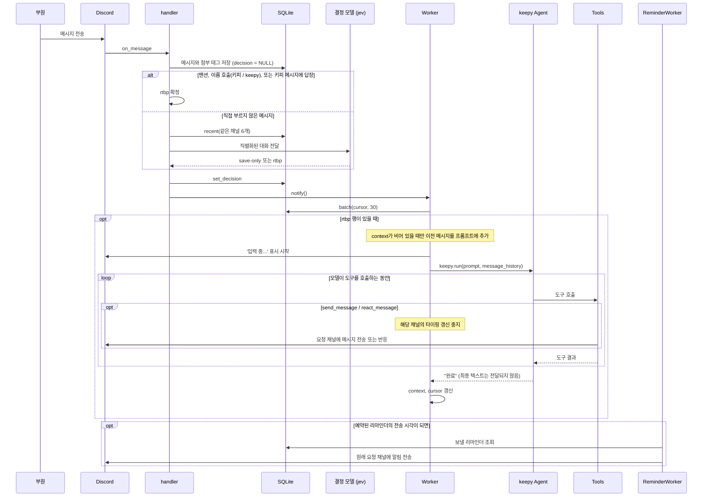
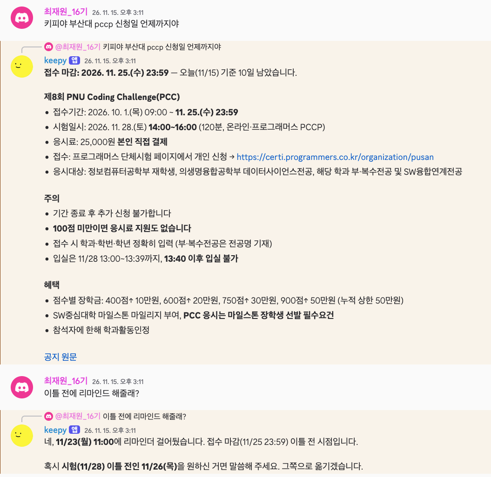

# keepy

KEEPER 디스코드 서버를 위한 에이전트로 자연스럽게 동아리 회원들 대화에 참여하고, 필요 시 도움을 줍니다.

### 기능들

- 디스코드 대화 맥락을 바탕으로 답변하거나 이모지로 반응해요.
- 서버의 지난 대화를 검색해요.
- 웹을 검색하고 링크의 내용을 요약해요.
- 국내 보안 뉴스와 Hacker News 글 및 댓글을 찾아줘요.
- 정보컴퓨터공학부 공지, 학사 일정, PBL실 빈 시간을 조회를 조회해줘요.
- 부산대 학식과 기숙사 식단을 알려줘요.
- Crab Fit 일정 조율 링크를 만들어요.
- 리마인더를 예약, 조회, 취소하고, 예약한 시간에 채널로 알림을 보내요.

### 설계 고민
채널마다 세션(대화)을 만들기보다는 서버 전체의 메세지를 읽으며 사람처럼 순차적으로 답장하도록 설계하였습니다. 

먼저 디스코드 메세지에 응답할지 여부를 멘션, 이름 언급 혹은 Jev를 통해서 판단하게 합니다.
판단이 되면 save-only, rtbp 태그를 붙이고 worker에 신호를 보내어 worker가 동작하게 합니다. 
(save-only 또한 신호를 보냅니다.)

worker는 마지막 처리 위치 다음부터 첫 미판정 메시지(`decision = NULL`) 직전까지 한 번 호출마다 확인합니다. 이 범위에서 메세지 최대 30건을 가져오고 예외적으로 rtbp 경우에는 그보다 오래된 부분도 가져옵니다.
배치에 rtbp가 있으면 에이전트를 실행하고, 함께 가져온 save-only 메시지는 대화 맥락으로 같이 제공합니다.

그리고 마지막으로 worker는 agent loop를 돌면서 적절히 도구를 호출하고 메세지로 응답합니다.
아래 다이어그램은 메세지 하나 전송될 때의 흐름을 보여줍니다.

코드적인 측면에서는 비동기(async/await)를 적극적으로 활용하였습니다.

### 스크린샷

